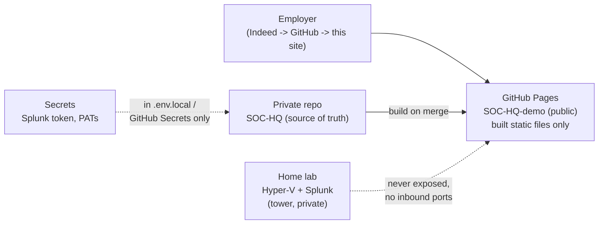

# SOC-HQ — Public Demo (read-only)

**Live demo:** https://williamrodgerscyber-bit.github.io/SOC-HQ-demo/

This is the employer-facing, read-only demo of **SOC-HQ**, a personal cyber
operations headquarters built beside a real Splunk home lab. It shows the
Mission Control screen: lab readiness, the SOC Analyst and Detection
Engineering workspaces, the Situation Room, and the Knowledge Center with
the 45-sheet cheat-sheet library.

## Read-only by construction

- There is **no backend, no database, and no login** in this demo. Nothing
  on this site can be changed from the browser.
- All data shown is **preset training data** — training-safe values only
  (`TEST-NET 198.51.100.x`, `TRAIN-WIN-01`). No live lab data, no real
  hostnames or IPs, no tokens, no credentials.
- The table-sheet library is not included in the public demo because it
  references the private lab.

## Architecture

- **Source of truth:** the private `SOC-HQ` repository. This public repo
  holds only the built static files and this README.
- **How it is built:** the React + Vite app is built in demo mode
  (`VITE_DEMO_MODE=true`), which answers the app's API calls with preset
  data instead of calling a server. The same screens and layout as the
  real app — only the data layer changes.
- **How it stays fresh:** a GitHub Actions workflow in the private repo
  rebuilds this site on every merge to `main` (see
  `.github/workflows/demo-rebuild.yml` there). It needs a fine-grained
  personal access token with Contents read/write on this repo only,
  stored as the `DEMO_SYNC_PAT` secret.

## What this demo is (and is not)

- It **is** a working front-end demo of the SOC-HQ Mission Control
  experience, with preset data.
- It **is not** the live lab. The live Splunk lab, the real app, and the
  private repository are not exposed here.
